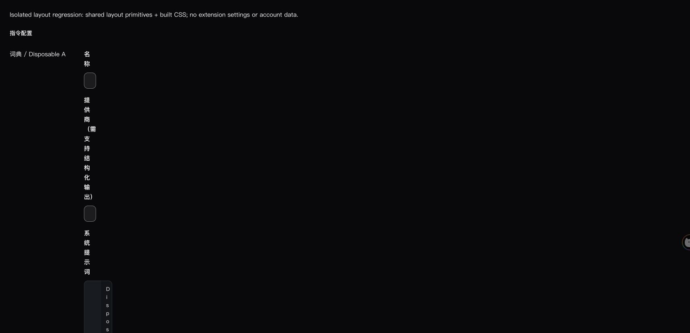
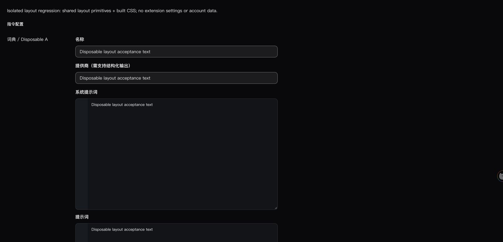
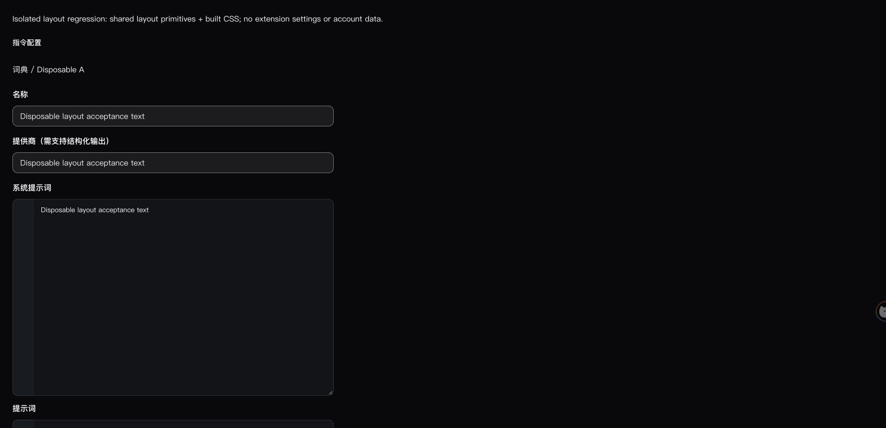

# 自定义 AI 指令编辑器布局回归修复

2026-10-15，用户在重新加载海外正式候选后提供设置页截图：右侧表单极窄，标签与输入内容逐字换行。本轮优先处理这一回归；H01、H02、Reddit、Telegram 仍按用户要求暂缓。

当前状态：**源码修复、工程回归、独立布局浏览器验证通过；用户已重新加载并确认实际设置页“布局已恢复正常”。动作编辑／执行仍待补验。** 未推进完整同步接纳。

## 原因与范围

固定上游的 `EntityEditorLayout` 增加了 `@container/entity-editor` 外壳。本仓保留的旧主题选择器 `#custom-actions > div:last-child > div > div:first-child` 因此从左侧列表改为命中整个双栏行，并对它施加 `width:208px; flex:0 0 208px`。右编辑器允许收缩，最终被挤到零宽。变量按钮采用 `max-content` 网格，因而出现变量仍横向展开而表单逐字竖排的组合。

这是一处**没有 Git 文本冲突的 DOM／主题适配遗漏**，不是用户配置或术语内容错误。

生产源码只修改 `src/fork/ui/options/custom-actions-theme.css`：通过命名容器定位实际布局行，取消错误宽度覆盖，列宽与上下排列交回共享组件；保留 24px 间距，右侧留白仅在宽容器生效。未修改共享组件、动作保存、模型、会员或队列。

图已刷新至 `e1d90dc9`：CustomActionsConfig 为 LOW、1 个直接调用；共享 EntityEditorLayout 为 HIGH、4 项依赖、2 个流程，已先向用户提示并避免修改共享组件。完整原始 JSON 见本目录 impact 文件。CSS 选择器不属于函数调用图的语义覆盖，另用实际组件选择器测试和浏览器几何验证。

## 验证

| 检查                                | 结果                                                                                                                                |
| ----------------------------------- | ----------------------------------------------------------------------------------------------------------------------------------- |
| 旧样式回归 RED                      | 2 失败、1 通过，失败指向整行固定宽度及间距误命中                                                                                    |
| 修复后相关测试                      | 7/7，通过                                                                                                                           |
| 完整主套件                          | 4996 通过、4 个外部在线服务测试按 `SKIP_FREE_API=true` 有意跳过                                                                     |
| 完整 fork 套件                      | 897 通过                                                                                                                            |
| 新文件类型／lint、改动文件格式      | 通过                                                                                                                                |
| 全仓类型／lint                      | 未通过：本次未修改的历史浏览器脚本和 `scripts/dev-local.node-test.mjs` 共 8 项诊断；原文保留在 `type-check.log`，不宣称全仓检查通过 |
| 固定目标边界、品牌、OpenSpec strict | 通过                                                                                                                                |
| 独立代码审查                        | 通过；审查者另跑布局与提供商两文件 6/6，通过                                                                                        |

独立浏览器样本只渲染真实 `ConfigItem`／`EntityEditorLayout`，配合实际构建 CSS 和临时字段，不代理扩展内部页面、不读取用户配置。原样式下，944px 容器的整行仅 208px，右编辑器 0px、输入框 30px；修复后左栏 208px、右编辑器 712px、输入框 688px。620px 容器下上下排列，列表、编辑器和输入框均为 620px，无编辑器水平溢出。

第一次样本漏载共享 theme 样式，已舍弃；补齐共享 theme 与 options 两份真实样式后才记录上述根因证据。对应中间观察保存在 `geometry-before.json`，没有追认为通过。

## 产物与实际扩展复核

最终海外生产构建置于 `.output/layout-fix/chrome-mv3-global`，原 `.output/chrome-mv3-global` 冻结包保持不变。最终包沿用原包的公开环境、渠道和 Google 客户端标识；manifest 完全相同。143 份 JavaScript 仅将 Vite 文件名哈希规范化后逐组对比，全部一致，不把构建文件名变化冒充源码逻辑变化。

- 原包：207 文件，tree SHA256 `ea567267f98550bfee72788d6e1e9e2e13e612ee2db28f5e4adc0d07f54f48d6`。
- 修复包：207 文件，tree SHA256 `6fb916949bfa25b7cc379096acb36cfd227d455e2d0cd5184b7699ab86eeb6fd`。
- 下载目录保持 `/Users/yisen/Downloads/TranslateBuff-Global-1.5.0-rf1.51.0-20261015`，原包已完整备份到 `download-package-update.json` 记录的路径；采用校验后的临时副本原子替换，没有修改 Chrome 档案或配置。
- 前两次构建的环境与原包不完全相同，均未安装，已舍弃；日志和带 `discarded-env-build` 后缀的比较保留。只有最终校验一致的包更新到下载目录。

浏览器工具禁止访问扩展内部页／扩展管理页，已请用户仅点“重新加载”并刷新设置页，无需卸载或重填配置。**用户随后确认“布局已恢复正常”，因此实际设置页布局视觉记为人工通过；动作编辑／执行未据此追认为通过。**

完整机器记录见 [result.json](result.json)。本轮源码仍是 `e1d90dc9` 上的未提交修复；未 push、发布或推进已接纳基线。

随后 Switch 回归生成了叠加两项修复的新包，下载目录当前包以 [Switch 产物记录](../switch-theme-fix/artifact.json) 为准；本页6fb包仍作为布局修复历史保留。
