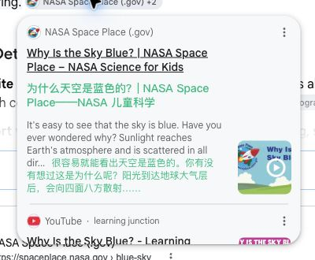
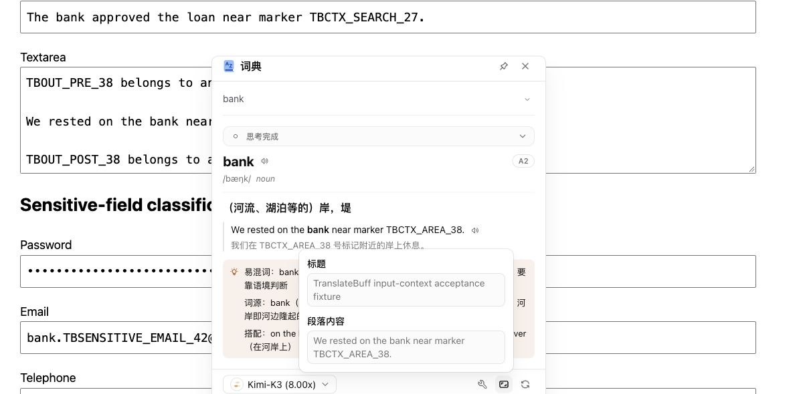
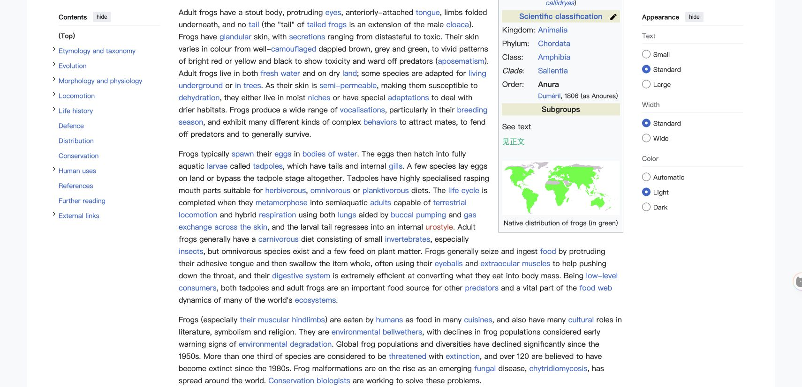

# 海外正式环境追加浏览器回归

2026-10-15，继续使用用户指定的现有 Chrome 和已登录的海外正式账号，测试冻结的海外候选包。结果为**已完成本轮可执行补测，存在两项未解决现象和覆盖限制**，不代表完整同步接纳。

- 源码 HEAD：`e1d90dc928ca5fbbbba112e480131e1c909c93ce`；目标仍为 Read Frog `v1.51.0` / `55bcef1e`。
- 网页翻译和划词翻译模型由用户手工选择为 `Kimi-K3`；划词实际结果 UI 显示 `Kimi-K3 (8.00x)`。未独立观察后台模型请求 ID、HTTP 状态或完整网络归属。
- 构建目录与用户加载的下载副本均为 207 文件，tree SHA256 均为 `ea567267f98550bfee72788d6e1e9e2e13e612ee2db28f5e4adc0d07f54f48d6`，见 [artifact-recheck.json](artifact-recheck.json)。本轮未改生产代码或重建候选。
- 用户明确排除 H01、H02、Reddit 和 Telegram；这些项目没有补测或关闭。

## 实际观察

| 项目 | 结果 | 证据与边界 |
| --- | --- | --- |
| P06 Google AI Overview 来源卡 | 实站通过 | 真实 Google 来源浮卡内实际生成 2 个译文 wrapper；摘要从 2 行、32px 高变为不截断、96px 高。保留内部 290px 高滚动区，内容高 485px；滚动后译文尾部位于可视区域。页面总 wrapper 也只有 2 个，没有触发整页翻译。 |
| P07 Wikipedia 短文本阈值 | 实站通过 | 同一 `See text`（8 字符）在字符阈值 30 / 词数 0 时无 wrapper；字符阈值 0 / 词数 0 时出现一个 wrapper，译为“见正文”。设置值由用户手工修改并反馈。 |
| P08 Kaggle Learn | 部分通过 | 实际 `.learnGuide` 段落翻译为中文，高度从约 22px 增至 61px；再次触发后 wrapper 消失，原文完整恢复。当前指南没有公式节点，**公式保护没有得到实站验证**。 |
| P05 普通 text / search / textarea | 真实模型六项通过 | 三种控件分别执行翻译和词典。翻译浮层中上下文与测试句相符；词典实际区分河岸与银行并回显对应例句。textarea 只取当前段，未带入前后 `TBOUT_` 段。属于本地受控表单加真实账号模型，不是第三方站点表单。 |
| P12 标签页标题开关 | 真实模型通过 | 开启时测试页标题译为“金丝雀项目 — TranslateBuff 验收”；关闭后恢复英文原标题，正文关闭再开启翻译仍保留英文标题。 |
| 本地术语添加和修改 | 真实模型通过 | 同一原文先命中“术语验收甲”，修改后普通关闭／开启翻译命中“术语验收乙”，甲消失；未清缓存。 |
| 自定义动作编辑器、翻译中心 | 用户反馈完成 | 用户按 [manual-ui-checks.md](manual-ui-checks.md) 完成编辑器与一模型／两模型文本清单。扩展内部页受工具 URL 策略限制，自动化未独立复核。翻译中心的多模型比较不等于多任务批量队列。 |

## 未解决现象

1. **F01：自定义动作未出现在真实工具栏。** 用户反馈已配置并启用 A；正常刷新后，在普通正文和输入框的划词工具栏中，均只观察到翻译／朗读／词典，没有 `TB-ACCEPT-E1D90DC9-A/B`。因此 A/B 的真实执行、结构化字段回显和 Layout 渲染均未通过。源码复核没有三个按钮上限或“更多”菜单，不能用裁切解释；尚不能判断为配置状态、同步或运行时接线问题，也不能归因为用户未操作。
2. **F02：术语删除后仍显示旧乙。** 用户反馈仅删除了测试词条，普通关闭／开启翻译仍出现乙；普通 HTTP 页面刷新后再翻译亦如此。保留缓存，未强制重译。删除的实际持久化状态、配置传播及缓存原因尚未区分，不能直接宣布缓存缺陷或删除回归通过。

## 证据边界

- 完整逐项观察见 [result.json](result.json)。前置预查和无效测试动作保留原状态，由后续结果关联，不将历史中间状态改写为通过。
- Google 首次严格命中检查遇到来源卡链接覆盖层，安全停止且未触发请求；后来确认单卡边缘命中后才执行。该停止不是扩展故障。一次 search 选区误命中标签，已舍弃并用核验过的控件选区补测。
- Wikipedia 首张裁剪截图没有包含目标，保留为 `wikipedia-short-low-threshold-wrong-clip.png`，不作为通过证据；有效图为完整视口的 `wikipedia-short-low-threshold.png`。
- 本轮没有 SW 归属请求日志，不能证明零上游商业请求；历史受控隔离证据仍保留原有范围。
- OTP 尝试未进入动作浮层；密码框选区时工具栏可见但没有执行动作。未读取敏感字段完整值或绕过工具脱敏。这些 UI 观察不能代替 getter 读取次数和最终请求 payload 的隐私验证，不能补齐 P05 的完整敏感负例矩阵或自定义动作组合。
- Wikipedia 页面存在 79 处嵌套表，仅能证明找到长页样本；未取得真实最终 prompt，不能以此补齐 P02 的实站裁剪／展平证明。
- React/Lexical、同源 iframe、body 替换、迁移／回退等仍沿用已明确标注的受控实包证据，没有冒充本轮实站结果。

## 截图

## 收尾

用户反馈这些手工操作过多，担心误操作，询问是否可由自动化完成。扩展内部页仍被浏览器工具 URL 策略禁止，因此**没有代为清理扩展配置，也没有宣称恢复完成**；不绕过限制、不猜测测试前原值。当前保留情况如下。

| 项目 | 最后已知状态 |
| --- | --- |
| 临时术语库 `验收临时-e1d90dc9` | 库未确认删除；词条用户反馈已删，但页面仍出现乙 |
| 临时动作 `TB-ACCEPT-E1D90DC9-A/B` | 用户反馈创建过；真实工具栏未显示；未确认删除 |
| 悬浮翻译 | 最后用户反馈为开启，未确认恢复 |
| 最少字符／词数 | 最后用户反馈均为 0，未确认恢复 |
| 标签页标题翻译 | 最后用户反馈为关闭，未确认恢复 |
| 翻译中心 | 清单反馈完成；测试输入清空及偏好恢复未独立复核 |

已关闭本轮创建的 input、glossary、Wikipedia、Kaggle、Google 五个测试标签，并停止仅绑定 `127.0.0.1:18765` 的自有 HTTP 服务。用户原有标签和浏览器档案保持打开。未确认删除整份临时库，因此最后一次“整库删除后”重译未执行；它不能替代此前删词异常或被追认为通过。

未提交、push、发布、上传商店或推进完整同步元数据；已接纳基线保持 `1.46.6` / `02ad422c`。
