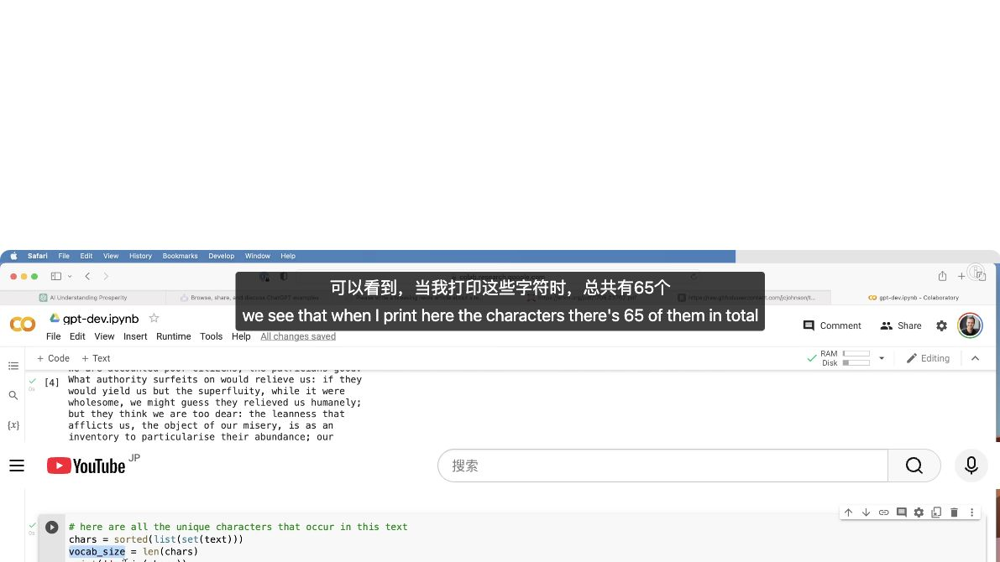
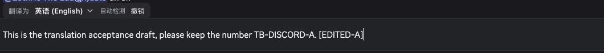

# 海外正式环境：YouTube / Discord 真实浏览器复测

2026-10-15，用户指定的 Chrome 已有档案。未复制登录凭据或另建用户档案。Google 登录由用户完成；官网实际 DOM 显示 PRO。用户手工加载并启用候选，随后又在正常 popup 中将“视频字幕”和“输入翻译”两项切换为默认自有模型。

候选为 TranslateBuff 1.5.0 / Read Frog 1.51.0，源码 HEAD `e1d90dc928ca5fbbbba112e480131e1c909c93ce`。手工加载目录：`/Users/yisen/Downloads/TranslateBuff-Global-1.5.0-rf1.51.0-20261015`，207 文件，canonical DFS tree SHA256 `ea567267f98550bfee72788d6e1e9e2e13e612ee2db28f5e4adc0d07f54f48d6`。

本轮两站核心 UI 流程通过。**这不等于完整 G3 / G5 或全部同步验收通过。** 当前工具只能观察 HTTP(S) 页及其 origin 范围的 CDP，不能独立读取扩展后台实际模型 ID、动态网关地址和逐请求 HTTP 状态。模型绑定依据用户的手工配置确认；可见输出属于真实翻译结果，不是 mock。

## YouTube

真实视频：<https://www.youtube.com/watch?v=kCc8FmEb1nY>。广告结束后正片时长 6979.901 秒，实际原生选中轨道为 English ASR，`kind=asr / language=en / vssId=a.en`。

| 项目 | 实际结果 |
| --- | --- |
| 注入 | 刷新后字幕按钮、字幕 host、`translate-buff` 和 `translate-buff-selection` 均存在。最初安装缺失问题已由用户手动加载解决。 |
| 原生字幕 | 实际 `/api/timedtext` 返回 200，`fmt=json3 / kind=asr / lang=en`；5910 个事件中 2954 个为 scrolling append。仅保存脱敏路径、状态和统计，不保存签名查询。 |
| 双语显示 | 默认微软先产生实际译文。用户改绑自有模型后，正常继续播放越过旧缓存范围；549.225 秒新 cue 曾显示“翻译中”，后返回中文译文。没有用关开后的旧 cue 立即显示来证明新模型。 |
| 时间轴 | 实际播放 485.118→525.012 秒，80ms 采样共 500 次，151 次原生 timeupdate，10 次双语 cue 转换。没有合成 timeupdate。 |
| 延长区间 | 实际 JSON3 的等价解析中，507.479 秒 cue 旧结束 512.280 秒、新结束 512.800 秒，增加 520ms。实际 DOM 对应相同 source hash/长度，从 507.660 秒维持到下一次 513.012 秒转换，新增区间未提前消失。 |
| 拖动 | 真实指针按下时 capture=true；拖出播放器并释放后 capture=false；无按键悬停不继续移动，后续再次拖动成功；视频保持暂停。 |
| 菜单 | 样式菜单真实 scrollTop 达 69.5；面板在播放器内；仅原文时 source 可见、translation 不可见，恢复双语后两者均可见；操作期间保持暂停。 |
| 未覆盖 | 原生设置菜单打开时扩展菜单关闭，没有同时重叠，不能声称本轮覆盖两菜单重叠点击层级。原字幕下载按钮已点击，但 tab 级 download 事件超时，未取到 SRT，未用其作时序证据。 |

时序预期来自当前源码等价的纯 JSON3 解析，与真实 DOM 采样对照；不是实际 SRT 导出的逐字节核验。采样只保留时间、长度和 hash，不保留整片字幕。40 秒样本中的前段译文包含此前微软缓存；不能将这 10 次转换全部记为自有模型请求。

## Discord

用户明确允许在有历史消息的现有会话验证。实际编辑器为 Discord 的 Slate：`[contenteditable=true][role=textbox][data-slate-editor=true]`。只读取测试 composer 和扩展 UI，未保存会话名称、频道 ID、历史正文或整页截图。翻译本身会按产品逻辑读取页面上下文，用户已授权在此会话执行。

| 项目 | 实际结果 |
| --- | --- |
| 三连空格 | 空输入框中写入专用中文 canary，三次真实 Space 触发，观察到 spinner，随后同一 Slate composer 显示英文译文并保留 `TB-DISCORD-A` 编号。 |
| 撤销 | 在译文末尾追加 `[EDITED-A]`，点击扩展“撤销”，准确恢复原中文和首尾各两个空格。 |
| 修改保护 | B 请求 pending 时追加 `STALE-GUARD`，后续检查内容未被旧译文覆盖。 |
| Escape | C 请求 pending 时按 Escape，spinner 消失，约 100 秒后的草稿仍为原文。 |
| 清理 | `fill('')` 未能清除 Slate 状态，改用真实 Meta+A / Backspace；最终仅剩空编辑器的 FEFF 占位字符，spinner=0。全程未按 Enter、未点击发送。 |

修改/取消后，工具没有直接观察到后台响应完成；这里证明 pending 期间操作和后续草稿保护，不声称网络请求已被中止或覆盖所有响应竞态。

## 收尾和证据边界

- YouTube 已暂停，字幕开关已关闭，页面翻译 wrapper=0；Discord 测试草稿已清空。
- 用户选择的 provider 保留；未关闭用户浏览器或删除其档案。
- 未修改生产代码或冻结产物，未 push、发布或推进同步元数据。
- 当前样本未发现上述核心流程的新增阻断；此前 H01 快捷键和 H02 GitHub 范围/429 问题不在本轮复测范围，不能由此关闭。
- 本轮没有完整扩展 service-worker 网络归属证据，不能给出“上游商业请求为零”或完整 G5 通过结论。

机器可读记录见 [result.json](result.json)。用户指定档案之前的全新 CFT 尝试另存于上层目录；其 Google 登录未完成，已明确标记为改用用户指定实例，不能与本轮混记。
