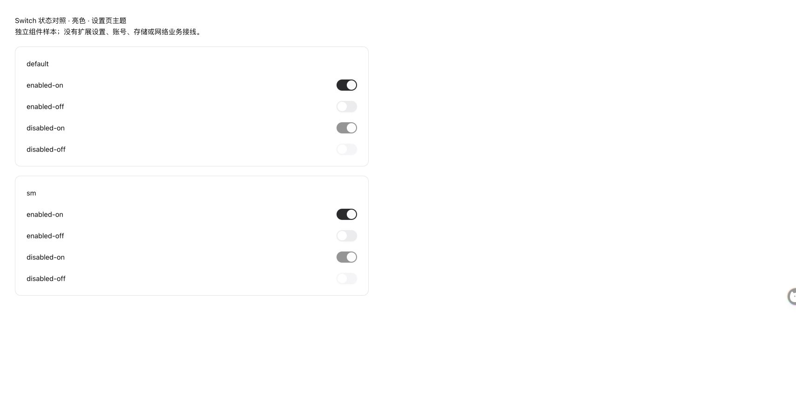
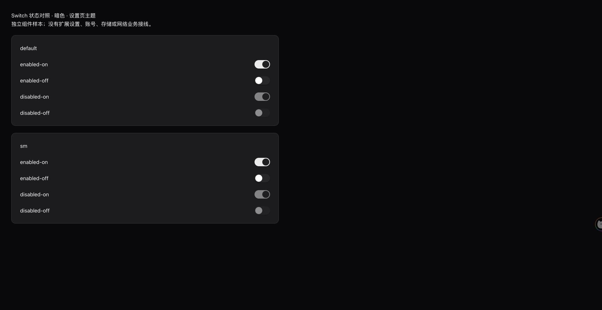

# Switch 主题与开启位置修复

2026-10-15，用户在确认自定义指令布局恢复后，提供亮暗主题截图，反馈 Switch 开启不明显。本轮继续同一 OpenSpec 变更；H01、H02、Reddit、Telegram 保持暂缓。

状态：**源码修复、独立实际组件浏览器回归、工程测试及代码审查通过；海外包已更新原目录，用户已重载并确认实际设置页“开关显示正常”。** 未推进完整同步接纳。

## 根因与最小范围

1. `src/components/ui/base-ui/switch.tsx` 保留 `data-checked:bg-accent-blue` 等旧 utility，但固定上游主题已删除对应 Tailwind token，实际构建没有这些颜色类。开启轨道为透明色。
2. 设置主题用 `--rf-switch-thumb-x/width/height/y` 将同一 Motion 动画映射到 44×24 的自有控件尺寸；合并后的组件丢失了变量出口，CSS fallback 将开启滑块同样定位在左侧。暗色 checked 滑块本为深色，因此与透明轨道一起消失在深色背景。

共享 Switch 图影响为 **CRITICAL，54 项影响、28 个直接调用、10 条流程、5 个模块**，已在编辑前向用户说明；完整 JSON 见 `impact-switch.json`。CSS 级联与运行时值不由调用图完整表达，另用实际浏览器测量补证。

生产修复仅两文件：

- 共享 Switch 恢复当前有效的 accent/ring utility，向原有 x MotionValue 及同一尺寸动画补回 CSS 变量出口。没有新增状态源，未改事件合并、取消、禁用、只读、拖拽判定或原组件尺寸。
- options 主题为 checked 轨道明确使用现有 primary，滑块使用 primary-foreground：亮色深轨浅钮、暗色浅轨深钮；关闭仍为原灰轨。保留原 Motion 位置映射。

此前的 `custom-actions-theme.css` 布局修复一并保留；对应用户确认已记录，不能据此认定自定义动作执行也已通过。

## 真实独立组件验证

使用真实 React Switch、真实源主题经 Vite/Tailwind 构建的 CSS，通过用户指定的同一 Chrome 普通 HTTP 标签运行。样本只包含临时开关和事件记录，没有扩展设置页、账号、存储、RPC 或业务网络接线；不是被禁止内部页的代理。

- 修复前亮暗主题均为 checked 轨道 `rgba(0,0,0,0)`；开启和关闭 thumbX 均为 2px。`verify-browser.mjs before` 按预期失败。
- 修复后设置主题 44×24：开启 thumbX 22px、关闭 2px。亮色开启轨道 rgb(43,43,46)、滑块 rgb(250,250,250)；暗色轨道 rgb(235,235,235)、滑块 rgb(32,32,35)。两种尺寸、可用／禁用及主题内外共16组状态对照通过。
- 点击、空格切换通过；禁用项点击后状态不变。拖拽中间位置约9.47px，按压形状同步缩放，证明不是 checked 静态瞬移。
- 最初未记录事件的样本两次释放后仍为 off，原观察保存在 `browser-after.json`，原因未精确归因。增加仅位于 fixture 的事件记录后，修复前后同一真实鼠标序列都只触发一次 `next=true`，随后 detail=1 的 click 被正确吞掉，最终为 on。独立审查另证实原有 detail=0 后续 click 分支可触发再次切换；本轮没有改该逻辑，不将组件模拟等同实际扩展所有拖拽场景签字。

几何、颜色与事件原文见 `browser-before.json` / `browser-after.json`。`verify-browser.mjs after` 通过。构建 helper 的 before 使用 `e1d90dc9` 冻结的两个源文件，以免事后重建混入修复代码。

## 工程与产物

- 主套件4996通过，4个外部在线测试在 `SKIP_FREE_API=true` 下有意跳过；fork套件897通过。格式整理后相关两文件7项再次通过。
- 独立审查通过；其相关fork回归7项及组件边界检查通过，限制见 `review.md`。
- 改动 Switch 单独类型／lint通过；全仓类型／lint仍有历史浏览器脚本及 dev-local 测试的8项现有诊断，见 `type-full.log`，不记全仓绿。
- 首次全仓检查误扫新建样本的 minified bundle，已将这些生成文件移动到正常忽略的 `.output/switch-fixtures/{before,after}`，没有修改lint配置或屏蔽生产源码。该次错误检查另存压缩日志；fixture helper的一项 consistent-return 也已修正，最终检查仅剩上述8项历史诊断。
- 固定目标 fork boundary、brand、OpenSpec strict及改动格式检查通过。图变化原文见 `graph-detect.txt`：6个tracked文件、9符号、1流程、medium；CSS与untracked测试不在函数符号汇总的完整覆盖内，不能替代将来提交前完整检查。
- 新包 `.output/switch-fix/chrome-mv3-global`，207文件，tree SHA256 `407fbe95a5c805ffaa72758ea904c6e489e74164d1f94fabc01fba2f7140fb3f`。沿用冻结海外生产环境、渠道、公开Google客户端值，manifest与原包完全一致。原冻结包和上一布局修复构建保持不变。
- 下载目录仍是 `/Users/yisen/Downloads/TranslateBuff-Global-1.5.0-rf1.51.0-20261015`，校验后原子替换，上一包完整备份。逐文件摘要、备份路径及JS变化清单见 `artifact.json`。没有访问或修改浏览器profile／用户配置。

浏览器策略禁止工具访问扩展管理页与内部设置页，需要用户仅“重新加载”后刷新当前页面，不能由文件替换推定浏览器已执行新包。用户已确认“已重载，开关显示正常”，实际设置页视觉记为人工通过；其余未完成测试和已接纳1.46.6基线保持原状态。源码仍为e1d90dc9上的未提交修复，未push、发布或归档。

若复现独立样本：运行 `node .../build-fixture.mjs before|after`，在 `.output/switch-fixtures` 启动仅本机HTTP服务，打开对应 `before/index.html?theme=light` 或 `after/index.html?theme=dark`；`scope=shared` 验共享组件。浏览器观察阶段原URL为18765端口的fixture路径，取证后仅将生成文件移至忽略目录，未改原始结果。

随后用户发现选择工具栏设置页触发云功能拒绝错误，已另建 [设置页修复记录](../selection-toolbar-settings-fix/README.md)。该问题不影响本次Switch显示确认；后续下载目录包以最新产物记录为准。
